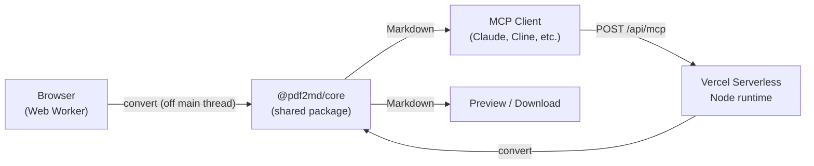

# Papel Tools

> **Privacy-first PDF to Markdown converter** —runs 100% in your browser. Files never leave your device.
> Also available as a remote MCP server for AI agents.

[]()
[]()
[]()
[]()

[Live demo](https://papeltools.com) · [MCP endpoint](https://papeltools.com/api/mcp) · [Server card](https://papeltools.com/.well-known/mcp/server-card.json)

---

## Table of Contents

- [Why Papel Tools?](#why-papel-tools)
- [Features](#features)
- [Quick Start](#quick-start)
- [MCP Quick Start](#mcp-quick-start)
- [Architecture](#architecture)
- [Tech Stack](#tech-stack)
- [Deployment](#deployment)
- [Privacy](#privacy)
- [Roadmap](#roadmap)
- [Contributing](#contributing)
- [License](#license)

---

## Why Papel Tools?

PDF —Markdown is the fastest-growing document-conversion category in 2025—026, driven by LLM/RAG demand for clean text. Every existing tool falls into one of three gaps:

1. **They upload your file** —privacy risk for sensitive documents (contracts, medical records, internal reports).
2. **No MCP support** —AI agents cannot chain them into workflows.
3. **English-only** —Latin American and Brazilian users get a poor experience.

Papel Tools fills all three:

- **100% client-side** —open DevTools —Network during conversion, confirm zero document requests.
- **Native MCP server** —`POST /api/mcp` with three tools (`convert_pdf`, `preview_pdf`, `list_supported_formats`).
- **Trilingual UI** —English, Spanish (es-419, Latin American), Brazilian Portuguese (pt-BR).

Open an incognito window, drop a PDF, and watch zero requests leave the page.

---

## Features

### Web Converter (zero uploads, browser-only)

- Text-based PDFs —Markdown via `@pdf2md/core` + `pdf.js` v5.
- Drag-and-drop or click-to-browse upload.
- Real-time progress + cancel (`AbortSignal`).
- Markdown preview, `.md` download, clipboard copy.
- Token / page / word / duration metadata.
- Trilingual UI: English, Spanish (es-419), Brazilian Portuguese (pt-BR).
- Hard limits: 200 MB upload, 15 MB engine ceiling —refuses larger files with clear messaging.
- Worker crash auto-retry —failed conversions transparently restart with the original buffer.
- Scanned PDFs —one-click OCR fallback (eng / spa / por via Tesseract.js, fully client-side).
- `SoftwareApplication` + `FAQPage` JSON-LD for AI-crawler discoverability.

### Remote MCP Server (`POST /api/mcp`)

- Streamable HTTP over JSON-RPC 2.0 (`@modelcontextprotocol/sdk` 1.30.x).
- Three tools: `convert_pdf`, `preview_pdf`, `list_supported_formats`.
- Stateless design —Vercel Serverless cold-start safe (no shared session map).
- IP rate limit (60/min) via `@upstash/ratelimit` (in-memory fallback in dev).
- Origin whitelist in production via `ALLOWED_ORIGINS` env (fail-closed by default).
- Discovery endpoint: `GET /.well-known/mcp/server-card.json`.
- Limits: **3 MB / 50 pages** —text-based PDFs only. Scanned PDFs return a clear error.

---

## Quick Start

### Prerequisites

- Node.js ≥?20.9.0 (Next.js 16 engine requirement).
- npm ≥?10 (or pnpm ≥?9, or yarn ≥?4).

### Install & Run

```bash
git clone https://github.com/taijilong727-ui/papeltools.git
cd papeltools
npm install
npm run dev
# open http://localhost:3000 (redirects to /en/)
```

### Build

```bash
npm run build     # hybrid: SSG + /api/mcp serverless
npm run start     # production server on port 3000
```

### Verify Locally

```bash
npm run typecheck   # tsc --noEmit (0 errors expected)
npm run lint        # eslint .
npm run test:unit   # Vitest (engine + MCP + i18n, 100+ tests)
npm run test:e2e    # Playwright (converter + privacy + OCR)
```

### Verify the Web Converter

1. Open `http://localhost:3000/en/`.
2. Drag any text-based PDF onto the converter.
3. Watch the progress bar; download `.md` or copy to clipboard.
4. **Privacy check**: DevTools —Network —confirm **zero document requests** during conversion.

### Verify the MCP Endpoint

```bash
curl -X POST http://localhost:3000/api/mcp/ \
  -H 'Content-Type: application/json' \
  -H 'Accept: application/json, text/event-stream' \
  -d '{
    "jsonrpc": "2.0", "id": 1, "method": "initialize",
    "params": {
      "protocolVersion": "2025-11-25",
      "capabilities": {},
      "clientInfo": {"name": "test", "version": "1.0"}
    }
  }'
```

Expected response includes `"serverInfo": { "name": "papeltools-mcp", "version": "0.2.0" }`.

---

## MCP Quick Start

The remote endpoint at `POST https://papeltools.com/api/mcp` speaks JSON-RPC 2.0 over Streamable HTTP.

### Discover

```bash
curl https://papeltools.com/.well-known/mcp/server-card.json
```

### List Tools

```bash
curl -X POST https://papeltools.com/api/mcp/ \
  -H 'Content-Type: application/json' \
  -H 'Accept: application/json, text/event-stream' \
  -d '{"jsonrpc": "2.0", "id": 1, "method": "tools/list", "params": {}}'
```

Returns three tools: `convert_pdf` (full conversion), `preview_pdf` (truncated to 4000 chars), `list_supported_formats` (capability introspection).

### Use with the MCP Inspector

```bash
npx @modelcontextprotocol/inspector https://papeltools.com/api/mcp
```

### Coming soon —Local stdio package

Phase 2 will publish `@papeltools/pdf-to-markdown-mcp`, a stdio transport that runs entirely on your machine and never contacts our server. Useful for maximum-privacy workflows and offline use.

---

## Architecture



**Key principle**: the in-browser worker and the serverless MCP function share the **same** `@pdf2md/core` package. There is one conversion pipeline, not two —change logic once, ship to both products.

The browser path runs entirely in a Web Worker (off the main thread) so the UI stays responsive even on 50-page PDFs.

The MCP path runs serverless on Vercel (Node runtime, `@pdf2md/core` resolved via `serverExternalPackages`). Stateless: every request creates a fresh `McpServer` and `WebStandardStreamableHTTPServerTransport`.

---

## Tech Stack

| Layer            | Choice                                              |
|------------------|-----------------------------------------------------|
| Framework        | Next.js 16 (App Router, **hybrid mode**)            |
| UI               | React 19 + Tailwind CSS v4                          |
| i18n             | next-intl v4 (EN / ES-419 / pt-BR)                  |
| Conversion       | `@pdf2md/core` (pdf.js v5)                          |
| Concurrency      | Web Workers (off-main-thread, browser)              |
| OCR              | Tesseract.js (eng / spa / por)                      |
| MCP SDK          | `@modelcontextprotocol/sdk` 1.30.x                  |
| Rate Limit       | `@upstash/ratelimit` + `@upstash/redis`             |
| Lint / Test      | ESLint 9 + Vitest 3 + Playwright 1.62               |
| Deployment       | Vercel Hobby (free tier)                            |

---

## Deployment

The project is pre-configured for **Vercel hybrid mode** (SSG pages + 1 serverless `/api/mcp`).

### One-Click Deploy

[](https://vercel.com/new/clone?repository-url=https%3A%2F%2Fgithub.com%2Ftaijilong727-ui%2Fpapeltools)

### Manual Steps

1. Import the GitHub repository in Vercel (framework auto-detected as Next.js).
2. Configure environment variables in **Settings —Environment Variables**:

   | Variable                        | Required | Notes |
   |---------------------------------|----------|-------|
   | `UPSTASH_REDIS_REST_URL`        | yes      | [Upstash Console](https://console.upstash.com) —REST API |
   | `UPSTASH_REDIS_REST_TOKEN`      | yes      | same |
   | `ALLOWED_ORIGINS`               | yes      | comma-separated. Example: `https://papeltools.com,https://www.papeltools.com` |
   | `MCP_REMOTE_URL`                | optional | override the public endpoint URL |

3. Click **Deploy**. Build takes 2— minutes (pdf.js + tesseract.js bundles are large).
4. After deployment, add `papeltools.com` in **Settings —Domains**.

### DNS Configuration

- **Registrar**: Spaceship.
- **DNS**: Cloudflare (free tier).
- **Records**:
- `CNAME @` → `cname.vercel-dns.com` (DNS only)
- `CNAME www` → `cname.vercel-dns.com` (DNS only)

Vercel auto-issues Let's Encrypt SSL once DNS resolves.

---

## Privacy

Papel Tools ships **two independent products** with separate privacy guarantees —please read both:

### Web Converter (browser)

- **Zero uploads** —open DevTools —Network during conversion, confirm **zero document requests**.
- Files are processed entirely in a Web Worker via `@pdf2md/core`.
- OCR fallback runs Tesseract.js in the same worker; language models cache in your browser.
- Locale preference is stored in a `NEXT_LOCALE` cookie. No analytics, no telemetry.

### Remote MCP Server (`/api/mcp`)

- Accepts PDF uploads **once**, performs conversion server-side on Vercel, returns Markdown.
- Files are **not** forwarded to any third party (no LLM calls, no content logging).
- Rate-limited per IP (60/min) via Upstash Redis; origin-restricted via the `ALLOWED_ORIGINS` environment variable (defaults to fail-closed).
- Subject to [Vercel's Privacy Policy](https://vercel.com/legal/privacy-policy).

### Maximum Privacy

For maximum privacy, use the upcoming **local stdio package** (`@papeltools/pdf-to-markdown-mcp`, Phase 2) —it runs entirely on your machine and never contacts our server.

---

## Roadmap

- [x] **Phase 1** —Web converter + remote MCP, Vercel hybrid mode (live).
- [ ] **Phase 2** —Local stdio npm package (`@papeltools/pdf-to-markdown-mcp`).
- [ ] **Phase 3** —MCP Registry / Smithery registration, OAuth.
- [ ] **Phase 4** —Blog, batch conversion, remote MCP OCR support.
- [ ] **Phase 5** —WebGPU TrOCR high-accuracy mode, AdSense (content pages only).

---

## Contributing

Issues and PRs are welcome on GitHub. For substantial changes:

1. Open an issue first to discuss the approach.
2. Run `npm run typecheck && npm run lint && npm run test:unit` before submitting.
3. For UI changes, also run `npm run test:e2e`.

The conversion engine lives in `lib/engine/` (shared by web + MCP). Please do not fork the logic across endpoints —extend the engine instead.

Translation contributions for `messages/es.json` and `messages/pt.json` follow the same i18n key structure; all three dictionaries must stay in sync with `messages/en.json`.

---

## License

This project is released under the [MIT License](./LICENSE).

- **Application code** (`app/`, `components/`, `workers/`, `lib/`, MCP routing) - MIT (see [LICENSE](./LICENSE)).
- **Conversion engine** (`lib/engine/`) - MIT, derived from `@pdf2md/core`.
- **Brand and trademarks** ("Papel Tools", "papeltools.com") - all rights reserved. The MIT license covers the code only; the brand name and domain are not licensed for reuse without permission. Contact us for collaboration.

---

Built with care. Files stay on your device. MCP agents check `/api/mcp`.
